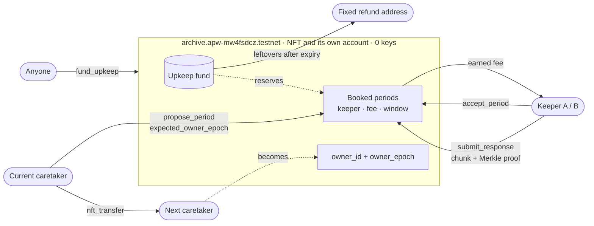

# ArchivePass

[](https://github.com/aarash-mohsin/archivepass-near/actions/workflows/ci.yml)

**Pass an archive on, with its upkeep money and its storage agreements attached.**

> Other NFT wallets carry a balance through a sale. ArchivePass carries **ongoing obligations to third parties** through a handover: storage keepers are paid only for Merkle proofs of the file, and the asset account has no keys.

**Live page:** <https://aarash-mohsin.github.io/archivepass-live/> · **Asset:** `archive.apw-mw4fsdcz.testnet` (NEAR testnet, funding open until 1 December 2026)

Small public archives, like a community's oral-history recordings, a school's open dataset or an open-source project's documentation, often stay online only because one volunteer pays for the hosting. When that person steps away, the archive tends to disappear. The money and the hosting arrangements sit in their personal accounts, and there's no clean way to hand them over.

ArchivePass makes the archive's stewardship an NFT that holds its own upkeep fund. Whoever holds the NFT can arrange future hosting, paid from a fund that can only be spent under fixed rules. Hosting providers ("keepers") are paid only after they answer a challenge with the right piece of the file. When the NFT moves to a new caretaker, the fund, the providers' existing agreements and the payments they've already earned all stay in place. The previous caretaker loses the authority to arrange service but cannot take the money with them.

Built for the **NFTs That Do Something** track of the NEAR Hackathon: the NFT is its own NEAR account, and it holds and spends money.

## Try it: do X, see Y

| Do | See |
|---|---|
| Open the [live page](https://aarash-mohsin.github.io/archivepass-live/) | 14 checks computed in your browser from public testnet RPC, each `PASS`, with transaction links: no keys on the asset, code hash = the committed WASM, books balanced, every keeper's Merkle proof re-verified from its transaction |
| Open **History** | Two caretakers (epoch 0, then Bob at epoch 1), the handover transaction, periods booked at epoch 0 that were answered and paid *after* the handover, and one missed period that earned nothing |
| Open **Fund**, connect a testnet wallet, fund 0.01 NEAR | Your wallet signs `fund_upkeep`; the ledger's total rises and your contribution appears in **History** |
| Open **Holder console**, click `apw-mw4fsdcz.testnet` | "Former caretaker, no access": it handed the NFT over and holds 0 tokens |
| Open **Holder console** and sign in with a wallet | A NEP-413 signed message is checked against your key and `nft_token`; the console unlocks only for the current holder |
| Run `pnpm install && npm run verify` | The same 14 checks in a terminal, ending `14 passed, 0 failed` |
| Run `pnpm test` | 87 application tests, including tampered-state tests that make every verify check fail |
| Run `pnpm test:contract` | 21 Rust tests, including a handover while a payout is in flight |
| Run `pnpm dev` and `pnpm seed`, open <http://127.0.0.1:5174> | The whole caretaker story on a local test ledger: book keepers, hand over, watch both keepers prove and get paid |

## How control passes on transfer

`nft_transfer` changes two fields: `owner_id` and `owner_epoch` (it goes up by one). Everything else stays where it was.

| Moves to the new caretaker | Stays fixed, whoever holds the NFT |
|---|---|
| The right to book future service periods (within the fixed caps) | Every booked period: keeper, fee, time window, content hash |
| The right to update a keeper's endpoint | Fees keepers have earned, and payouts already in flight |
| The right to hand the NFT on | The upkeep fund (nobody can withdraw it) and the fixed refund address |

**What stops the old caretaker.** Every owner method checks that the caller is `owner_id` *and* that its `expected_owner_epoch` is current, so a transaction signed before the handover fails with `STALE_OWNER`. There is no withdrawal method, no approvals (NEP-178) to leave behind, and the asset account has no keys, so the code can't be changed. The full list of attacks, with the code line, test and transaction that stops each, is in [THREAT_MODEL.md](THREAT_MODEL.md). Every claim is mapped to code, test and transaction in [CLAIMS.md](CLAIMS.md).



**Why not just use Arweave or Filecoin?** ArchivePass doesn't replace storage. It's the transferable part: who is responsible, what money is set aside, and which agreements the next caretaker inherits. Any storage provider could act as a keeper.

## How it works

1. **Create the asset.** A public file is split into chunks and hashed into a Merkle root. The asset contract fixes that content identity, a funding policy (eligible providers, maximum rates, an expiry date) and a refund address for unused money.
2. **Fund it.** Anyone can add upkeep money until the policy's expiry date. It can only be paid to eligible providers for service they've delivered, or returned to the fixed refund address.
3. **Schedule service.** The NFT holder proposes a service period for a provider. The provider accepts it on chain.
4. **Challenge and pay.** During a period, anyone can open a challenge, and the contract picks a random chunk of the file. The keeper answers with the bytes and a Merkle proof. If the contract accepts it in time, the keeper earns a fixed payment and can claim it. A missed answer earns nothing.
5. **Hand over.** Transferring the NFT moves the authority to a new caretaker. Commitments, earned payments and the refund address don't change.

The asset contract is in `contract/` (with a test receiver in `contract/receiver/`). Two separate keeper processes (`keeper/`) store their own copies of the file, answer challenges and claim payments automatically. The web app (`web/`) and API (`server/`) cover the caretaker, sponsor, keeper and public-reader views.

## See it on NEAR testnet

| Component | Account |
|---|---|
| Archive asset (NFT + fund) | [`archive.apw-mw4fsdcz.testnet`](https://testnet.nearblocks.io/address/archive.apw-mw4fsdcz.testnet) |
| Current caretaker (NFT owner) | [`bob.apw-mw4fsdcz.testnet`](https://testnet.nearblocks.io/address/bob.apw-mw4fsdcz.testnet) |
| Keepers | [`a.apw-mw4fsdcz.testnet`](https://testnet.nearblocks.io/address/a.apw-mw4fsdcz.testnet), [`b.apw-mw4fsdcz.testnet`](https://testnet.nearblocks.io/address/b.apw-mw4fsdcz.testnet) |
| Fixed refund address | [`refund.apw-mw4fsdcz.testnet`](https://testnet.nearblocks.io/address/refund.apw-mw4fsdcz.testnet) |

**The asset account has no access keys.** It was created, funded, deployed and initialized in [one transaction](https://testnet.nearblocks.io/txns/GeaYLrKs6XvgBoy64keqWxEGVvtUUtDq4ZEHimQ5BcgE) with no AddKey action, so nobody can change its code or move its money outside the contract's rules. The contract has no upgrade, no generic execute and no owner withdrawal method.

**Funding is open until 1 December 2026**, so the asset is live through judging: anyone can add upkeep, and Bob, the current caretaker, can schedule more service.

Key transactions from the signed run on 6 November 2026:

| Step | Transaction |
|---|---|
| Upkeep funded (0.02 NEAR) | [`C3LYenrk…`](https://testnet.nearblocks.io/txns/C3LYenrkBUNxjZYW7VNZyAgtQL46sEYMNGxfXv2ik1NS) |
| First caretaker schedules a period for keeper A | [`89H1wipw…`](https://testnet.nearblocks.io/txns/89H1wipwcwffWxYiA9gzHBoXyTXQt6BgGWNLrUGTp5e1) |
| NFT handed over to Bob | [`4dpF6GYy…`](https://testnet.nearblocks.io/txns/4dpF6GYyxLadANYswo1kAKdCSPLYUNqo82JGEQnWJyqC) |
| Bob, the new caretaker, schedules a later period | [`3UNTPasc…`](https://testnet.nearblocks.io/txns/3UNTPasc3DXeLJYEc7k3j9iYDB2VQYf5YH1hLuBAzWmm) |
| Keeper A opens a challenge on a period agreed before the handover | [`BoaGztdP…`](https://testnet.nearblocks.io/txns/BoaGztdPSvrHJjEHHzsN6PFPg57MDsa2LLTSv7aAm72h) |
| Keeper A answers with the chunk and its Merkle proof | [`4mBoEtUV…`](https://testnet.nearblocks.io/txns/4mBoEtUV8an7EFWZqmmnGBZfmYMY33g8hik9WaEUeQ5F) |
| Keeper A claims its payment | [`7AtPXRwN…`](https://testnet.nearblocks.io/txns/7AtPXRwNvsTPjUTtdnWRMvyMp2k5uvfkEpqpdhD9UHH4) |
| Keeper B answers and claims | [`2hBEEJmU…`](https://testnet.nearblocks.io/txns/2hBEEJmUX8poMxuYrrK6P1NKBhTA5N74KcMKg7Kt6ZbZ), [`9UjdvpT9…`](https://testnet.nearblocks.io/txns/9UjdvpT9j4DYCnTBfFNBGCRn55bdqefp1eS2ZBDe6p9v) |
| A period keeper A missed while stopped is closed unpaid | [`GXKSMQYT…`](https://testnet.nearblocks.io/txns/GXKSMQYTzKbhdDkXVAofimypqVPvvBLn81eCaudpYXyB) |
| 7 Nov: a separate sponsor account adds 0.01 NEAR of upkeep | [`7L6hSvfx…`](https://testnet.nearblocks.io/txns/7L6hSvfxJDjHgH2YdATwyU7otUcqDp4Hxsjahxo9unYn) |

The full run is in [`docs/RELEASE_WORKERS-final-evidence.json`](docs/RELEASE_WORKERS-final-evidence.json). An earlier deployment of the same contract, whose funding window has closed, is listed in the [evidence index](docs/EVIDENCE_INDEX.md).

### Check the contract yourself

One command runs every check against the live asset (read-only, no wallet or keys):

```sh
pnpm install --frozen-lockfile
npm run verify          # 14 PASS/FAIL lines; add --json for machine-readable output
```

It reads the asset over public RPC, rebuilds its history from every transaction sent to it (FastNEAR transaction API), hashes `contract/target/near/archivepass.wasm` and `fixtures/stewardship-guide.txt`, and re-verifies each keeper's Merkle proof from its transaction arguments. The [live page](https://aarash-mohsin.github.io/archivepass-live/) runs the same code (`shared/live.ts`) in the browser.

Or make the raw calls yourself. Read-only calls against the public testnet RPC, with no wallet needed:

```sh
# Access keys on the asset account; expect "keys": []
curl -s https://rpc.testnet.near.org -H 'Content-Type: application/json' -d '{"jsonrpc":"2.0","id":1,"method":"query","params":{"request_type":"view_access_key_list","finality":"final","account_id":"archive.apw-mw4fsdcz.testnet"}}'

# Who holds the NFT; expect owner_id bob.apw-mw4fsdcz.testnet  (args: {"token_id":"archive"})
curl -s https://rpc.testnet.near.org -H 'Content-Type: application/json' -d '{"jsonrpc":"2.0","id":1,"method":"query","params":{"request_type":"call_function","finality":"final","account_id":"archive.apw-mw4fsdcz.testnet","method_name":"nft_token","args_base64":"eyJ0b2tlbl9pZCI6ImFyY2hpdmUifQ=="}}'

# The fund's books; expect principal_in = principal_paid + available_upkeep and conservation_residual "0"
curl -s https://rpc.testnet.near.org -H 'Content-Type: application/json' -d '{"jsonrpc":"2.0","id":1,"method":"query","params":{"request_type":"call_function","finality":"final","account_id":"archive.apw-mw4fsdcz.testnet","method_name":"get_ledger","args_base64":"e30="}}'
```

`result.result` in the last two responses is a byte array of JSON text. After the signed run the ledger showed 0.02 NEAR funded, 0.003 NEAR paid to keepers and 0.017 NEAR available; the sponsor's 0.01 NEAR on 7 November brought the total funded to 0.03 NEAR. The deployed code hash `8DVxZxb2nD3zST8tky1jPTbWvLJfs8vfLXzrB7AMgSNN` matches `contract/target/near/archivepass.wasm`; CI checks this on every push. `node scripts/testnet-view.mjs` prints the same state in one go.

## Run it locally

Requires Node.js 24+ and pnpm 11.25.0.

```sh
pnpm install --frozen-lockfile
pnpm dev     # API on 8788, web app on 5174, keepers on 8791 and 8792
```

In a second terminal, load the sample archive:

```sh
pnpm seed
```

Open <http://127.0.0.1:5174>. The first start writes a local operator token to `data/app/operator-token`; paste it into **Operator access** in the app to enable changes. It is not a wallet key. The seed is safe to run more than once. It loads an original CC0 guide (three chunks) into both keepers and schedules two short 120-second service periods.

The browser app runs on a clearly labeled **local test ledger** with demo identities, and payments there are simulated. The real NEAR transactions are made by the owner CLI and the two signed keeper workers (see [docs/RELEASE_WORKERS.md](docs/RELEASE_WORKERS.md)). The app's **Testnet evidence** view reads the deployed asset; choosing a local role never signs a blockchain transaction.

`pnpm scenario`, with the app started with `ARCHIVEPASS_DEV_FAULTS=1`, runs a real-time outage and refund scenario in about 70 seconds. It pauses a keeper, lets its deadlines pass, and restores both keepers afterwards.

## Tests

```sh
pnpm test            # 87 application tests
pnpm typecheck       # strict TypeScript
pnpm build           # production frontend
pnpm test:contract   # 21 Rust tests; needs Rust
pnpm build:contract  # optimized WASM; needs Rust, the wasm32 target and cargo-near
```

The results of the last full release check are in [`release-qa/RELEASE_GATE.md`](release-qa/RELEASE_GATE.md). The full output of the final test run is in [`release-qa/archivepass-recovery-final-tests.log`](release-qa/archivepass-recovery-final-tests.log).

## Repository layout

| Path | Contents |
|---|---|
| `contract/` | Rust asset contract (`src/`) and test receiver (`receiver/`); committed release WASMs under `target/near/` |
| `keeper/` | Keeper service: local file store, challenge answers, and the signed testnet worker (`testnet-main.ts`) |
| `server/` | Node API with SQLite storage and the read-only testnet reader |
| `web/` | React app on the local test ledger, including the Testnet evidence view |
| `site/` | The hosted live page: verify, history, wallet funding and holder console (`npm run build:site`) |
| `shared/live.ts` | Read-only live checks and history, used by the live page and `npm run verify` |
| `shared/`, `fixtures/` | Shared protocol code, and the sample CC0 file and protocol fixture |
| `scripts/` | Dev, build, seed, scenario, backup/restore, the owner CLI and the testnet scripts |
| `tests/` | Contract-model, server, keeper, browser-logic and release tests |
| `THREAT_MODEL.md`, `CLAIMS.md` | Attacks on a handover and what stops each; every claim mapped to code, test and transaction |
| `docs/` | Design notes and on-chain evidence; start with the [evidence index](docs/EVIDENCE_INDEX.md) |
| `release-qa/` | Fresh-install, restore, dependency and browser checks |

The testnet scripts are for creating a **new, dedicated** testnet deployment. `testnet-deploy.mjs` refuses an existing account, and `testnet-scenario.mjs` refuses an asset that already holds funds. Their keys are written to the ignored `.secrets/` folder and never committed.

## Known limitations

- **Testnet only.** There is no mainnet deployment.
- **A passed challenge proves less than full storage.** It shows the keeper produced the requested chunk in time. It does not prove full-file availability, continuous uptime, an independent copy or permanent storage, and a keeper could fetch the bytes from somewhere else. Downloading the whole file and checking its hash in the browser is a separate check.
- **Both keepers run on the same computer** in this demo.
- **The local app doesn't sign transactions.** Its chain view is read-only, and its own actions run on a local test ledger. Live chain writes come from the owner CLI, the keeper workers, and the wallet buttons on the [live page](https://aarash-mohsin.github.io/archivepass-live/) (fund, book a period, hand over).
- **The live page's holder console is a client-side check.** A static page can't keep secrets; the real gate is the contract's own owner check, which the console's buttons go through.
- **The live page's history depends on the FastNEAR transaction API.** If it is unreachable, the page falls back to a snapshot recorded at build time and says so.
- **The 256-record capacity test was not repeated on the final contract build.** An earlier build reached 256 records. A partial run on the final build reached 16 before public RPC rate limits stopped it, and all its funds were refunded. See [docs/RELEASE_TESTNET_BENCHMARK.md](docs/RELEASE_TESTNET_BENCHMARK.md).

## Built with

- **Contracts:** Rust, [near-sdk](https://github.com/near/near-sdk-rs) 5.30; the contract implements the NEP-171 NFT methods itself
- **App:** TypeScript, React 19, Vite, Node.js 24 (built-in SQLite), [near-api-js](https://github.com/near/near-api-js) 7.4
- **Live page:** [near-connect](https://github.com/hot-dao/near-connect) 0.12 for wallets, [@noble/curves](https://github.com/paulmillr/noble-curves) for NEP-413 signature checks, FastNEAR RPC and transaction API, hosted on GitHub Pages
- **On chain:** NEAR testnet
- **AI tools:** OpenAI Codex with OpenAI's GPT-6 Astra model, used as a coding assistant for implementation and for the review passes recorded in `docs/ASTRA_*.md`.

The exact versions are pinned in `package.json`, `pnpm-lock.yaml` and `contract/Cargo.lock`.

## Development history

The project was built locally during the hackathon and put under Git only when it was published, so the first commit contains the finished work. The testnet deployments give independent dated evidence: the first deployments were made on 5 November 2026, and the current asset on 6 November 2026 (see the [evidence index](docs/EVIDENCE_INDEX.md) and the explorer links above).

## License

[MIT](LICENSE)
